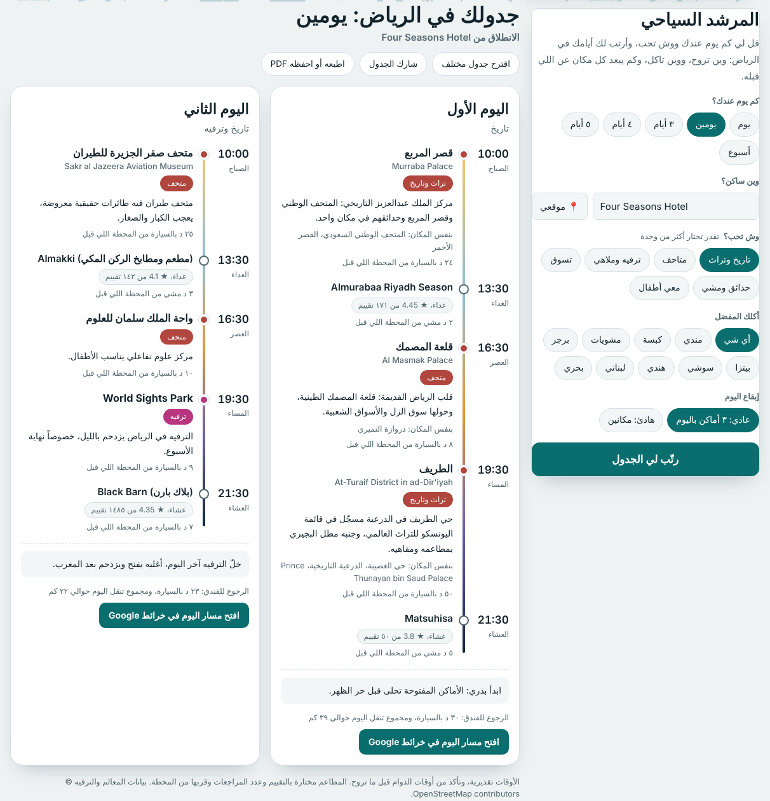
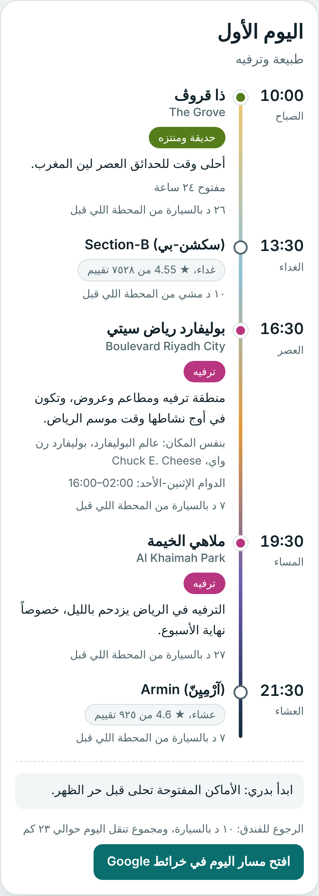

<div align="center">

# أقرب خدمة للفندق + المرشد السياحي

**نزلت فندق في الرياض؟ اسأل مثل ما تسولف، وخذ جوابك.**

### [جرّب الموقع الآن](https://mega-eng.github.io/riyadh-hotel-guide/)

`https://mega-eng.github.io/riyadh-hotel-guide/`

</div>



## الفكرة

توصل الفندق تعبان، وأول سؤال يجي في بالك: **وين أقرب كوفي؟** أو **وش أسوي هاليومين في الرياض؟**

عادةً تفتح خرائط Google، وبعدها تطبيق ثاني للمطاعم، وبعدها تبحث «أماكن سياحية في الرياض» وتقرا مقالات طويلة، وفي النهاية تحاول تربط كل هذا بموقع فندقك.

هنا تكتب سؤالك **بكلامك العادي**، باللهجة أو بالفصحى أو بالإنجليزي، والصفحة تفهم وش تبي وتجاوبك على طول:

- وين أقرب مكان يناسبك، وكم يبعد، وكم دقيقة مشي.
- ولو تبي، جدول كامل لأيامك في الرياض.

## جرّب تكتب

| تكتب | تحصل |
|---|---|
| `وين اقرب دانكن من فندق هيلتون` | أقرب فروع دانكن لفندقك، مرتبة بالمسافة |
| `ستار بكس جنب الشيرتون` | يفهم «ستار بكس» مفصولة و«الشيرتون» بدون همزة |
| `مطعم شاورما قريب مني` | يستخدم موقعك (بإذنك) ويطلع أقرب محلات الشاورما |
| `افضل ٣ كافيهات تقييمها فوق ٤ جنب ماريوت` | يرتب بالتقييم ويفلتر حسب شرطك |
| `اقرب ملاهي من الفورسيزونز` | ملاهي وترفيه حول الفندق |
| `عندي يومين في الرياض ومعي اطفال وساكن في ماريوت` | يفتح المرشد السياحي ويرتب لك يومين يناسبون العائلة |
| `اقرب صيدلية` | يقول لك بصراحة إن بيانات الصيدليات مو موجودة، بدل ما يخمّن |

## المرشد السياحي

تقول له **كم يوم عندك**، و**وين ساكن**، و**وش تحب**: تاريخ، متاحف، ترفيه، تسوق، حدائق، أو «معي أطفال». ويرتب لك كل يوم:

- **صباح، غداء، عصر، مساء، عشاء**: كل وقت بالشي اللي يناسبه. الأماكن المفتوحة الصبح قبل الحر، والترفيه بالليل.
- الأماكن **قريبة من بعض ومن فندقك**، فما تقضي يومك في الزحمة.
- **نصيحة قصيرة** مع كل مكان، مثل: «حي الطريف في الدرعية مسجّل في قائمة اليونسكو للتراث العالمي».
- **زر يفتح مسار اليوم كامل** في خرائط Google.
- تقدر تطلب **جدول مختلف**، أو **تشاركه** برابط، أو **تحفظه PDF**.

<div align="center">

</div>

## ليش مختلف؟

- **يفهم اللهجة السعودية**: «ابغى»، «وين فيه»، «جنب»، «نص كيلو»، «خمس مطاعم»، وحتى الأخطاء الإملائية مثل «ستاربك» و«هيلتن».
- **يعرف المحلات بأسمائها**: أكثر من 250 علامة تجارية (دانكن، ستاربكس، البيك، كودو…)، ويعرف أنواع الأكل (مندي، شاورما، سوشي…).
- **كله داخل متصفحك**: ما فيه سيرفر ولا تسجيل حساب. موقعك يُستخدم داخل الصفحة وما يُرسَل لأي سيرفر، إلا إذا فتحت الاتجاهات في خرائط Google.
- **سريع وخفيف**: صفحة وحدة تفتح على الجوال وتشتغل مباشرة.
- **تقدر تسأله بصوتك** في Chrome وSafari.

## بالأرقام

- **162** فندق وشقة مفروشة في الرياض.
- **أكثر من 23 ألف** مكان: مطاعم، كافيهات، نوادي، سوبرماركت، مغاسل.
- **250** معلم ومكان ترفيه ومول وحديقة من OpenStreetMap.
- **9 فئات** تبحث فيها، و**22 نوع أكل**.

## حدود المشروع (بصراحة)

- البيانات للرياض فقط حالياً.
- المعالم والترفيه ما فيها تقييمات، وأوقات الدوام متوفرة لعدد قليل منها. **تأكد من الدوام قبل ما تروح.**
- النموذج تدرّب على جمل مولّدة، فممكن يغلط في صياغات غريبة. إذا لقيت سؤال ما فهمه، [افتح Issue](https://github.com/mega-eng/riyadh-hotel-guide/issues) واكتب السؤال، وهذي أكثر شي يساعد في تطويره.

<details>
<summary><b>للمطورين: كيف يشتغل من الداخل؟</b></summary>

<br>

بدون نموذج لغة كبير ولا API. كل شي يشتغل في المتصفح:

| الجزء | الطريقة |
|---|---|
| نوع الخدمة، والأقرب أو الأفضل | مصنّفان Logistic Regression على ميزات كلمات ومقاطع حروف |
| استخراج الفندق والعلامة والمسافة والتقييم والعدد | واسم كلمات (BIO tagger) Logistic Regression |
| مطابقة أسماء الفنادق والمحلات | TF-IDF على مقاطع الحروف مع «بصمة نطقية» تربط العربي بالإنجليزي |
| «قريب مني»، نوع الأكل، تصحيح الإملاء، طلبات الرحلات | طبقة قواعد فوق النماذج |
| المرشد السياحي | مخطِّط يختار الأماكن حسب وقت اليوم والاهتمامات والقرب، والمطاعم بالتقييم مع عدد المراجعات |

- التدريب بـ scikit-learn في Python، والأوزان تُصدَّر JSON ويشغّلها JavaScript.
- الكود والنماذج وسكربتات البناء والتقييم في مجلد [`nlp/`](nlp/)، والتفاصيل والأرقام في [`nlp/README.md`](nlp/README.md).

**إعادة البناء:**

```bash
cd nlp
python3 build_brands.py page_v1.html
python3 train.py page_v1.html
node eval.js
python3 build_places.py riyadh_places.tsv places.json
python3 build_page.py page_v1.html ../index.html
```

</details>

## البيانات والشكر

بيانات المعالم والترفيه والمولات والحدائق من **OpenStreetMap**: © OpenStreetMap contributors، رخصة [ODbL](https://www.openstreetmap.org/copyright).

---

<div align="center">

**English:** An Arabic-first assistant for hotel guests in Riyadh. Ask in plain dialect, for example "nearest Dunkin to my hotel" or "plan 2 days with kids", and get nearby places or a full day-by-day itinerary. It runs entirely in your browser: no server and no account. Your location is used inside the page only, unless you open directions in Google Maps.

### [Try it live](https://mega-eng.github.io/riyadh-hotel-guide/)

</div>
